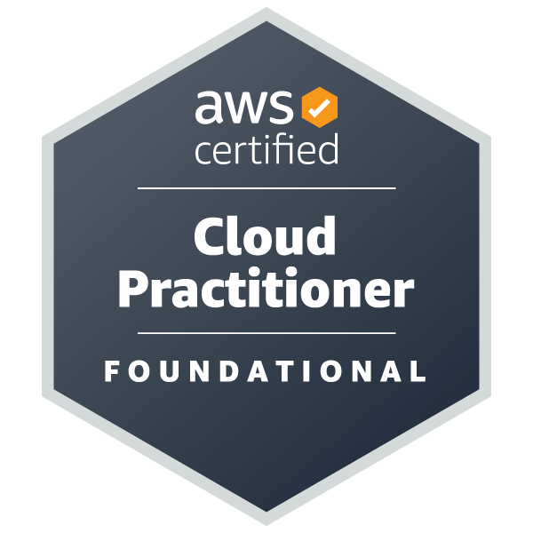
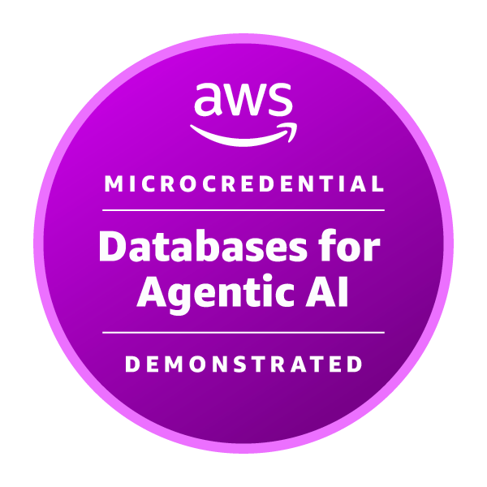
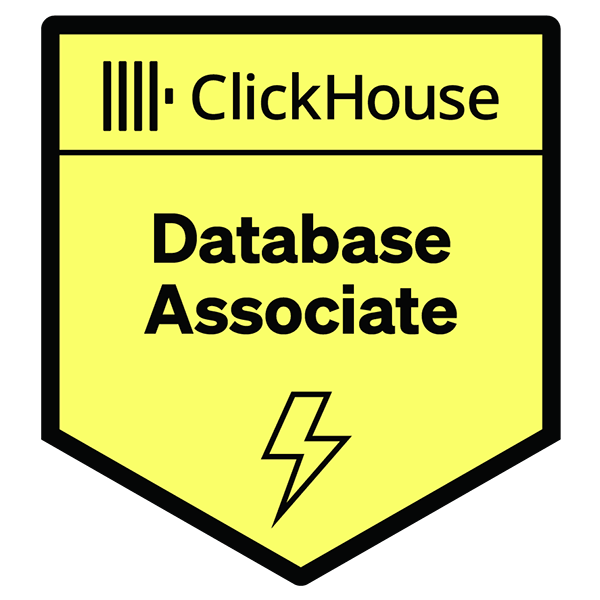

# Hi, I'm Sayli 👋

**Oracle DBA · 12 years experience · Currently exploring PostgreSQL & AWS cloud databases**

---

### 🛠️ What I work with

---

### 🏅 Certifications

  
  
  

---

### 🚀 Featured Projects

#### [pg_query_guardian](https://github.com/sskhedekar/pg_query_guardian)
> Self-contained PostgreSQL watchdog that automatically terminates runaway SELECT queries on AWS RDS read replicas.

Built entirely in PL/pgSQL — no Lambda, no EC2, no external dependencies. Born from a real business requirement and a frustration with fragile EC2-based solutions.

✅ pg_cron + dblink architecture &nbsp;·&nbsp; ✅ Full audit log &nbsp;·&nbsp; ✅ Exemption system &nbsp;·&nbsp; ✅ Dry-run mode

---

#### [patroni-ha-aws](https://github.com/sskhedekar/patroni-ha-aws)
> 3-node PostgreSQL 17 high-availability cluster on AWS EC2, built entirely by hand — no automation tools.

Every component was installed, configured and verified manually to understand HA internals: etcd leader election, WAL streaming replication, HAProxy health-check routing, Keepalived VIP failover, and pgBackRest S3 backups taken from the standby.

✅ Patroni + etcd &nbsp;·&nbsp; ✅ HAProxy read/write split &nbsp;·&nbsp; ✅ Keepalived VIP &nbsp;·&nbsp; ✅ pgBackRest to S3

---

### 📖 Currently learning

- PostgreSQL internals — replication, extensions, PL/pgSQL
- AWS RDS & Aurora operational patterns
- Database automation without external infrastructure

---

### 📬 Connect

